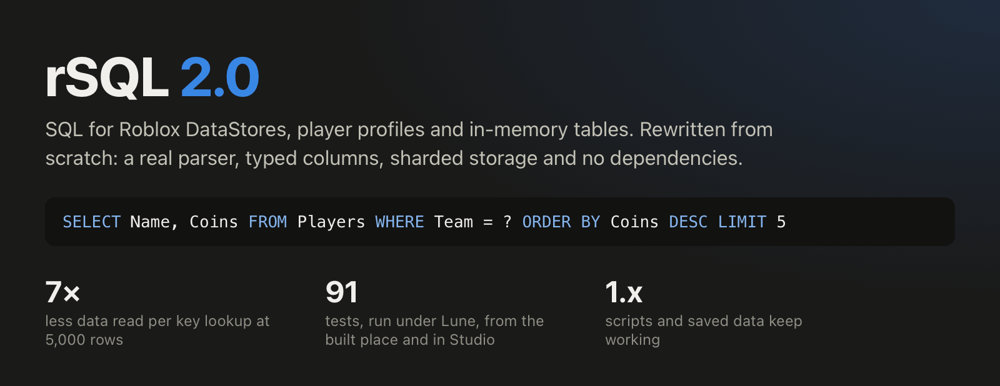
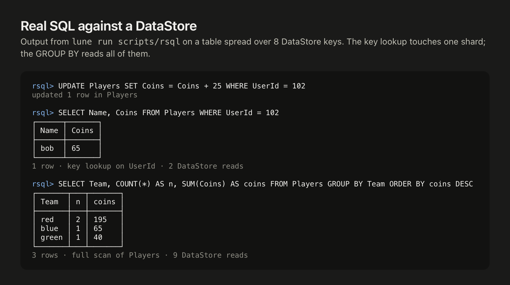
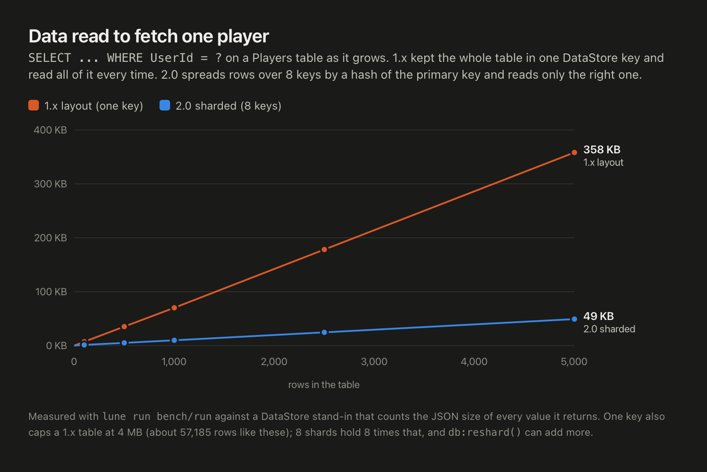
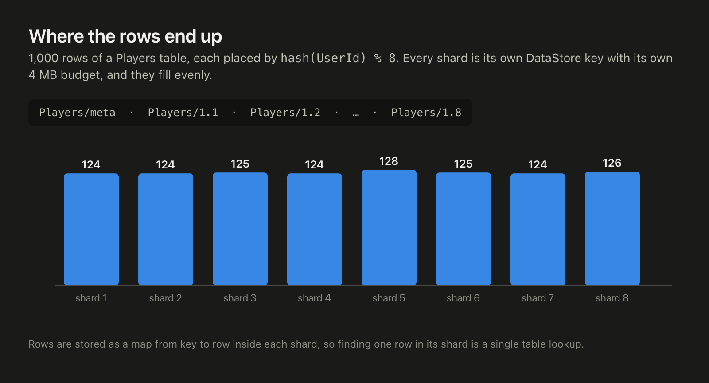
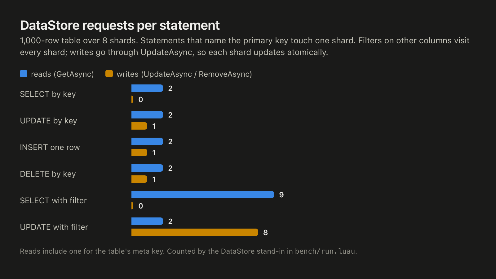
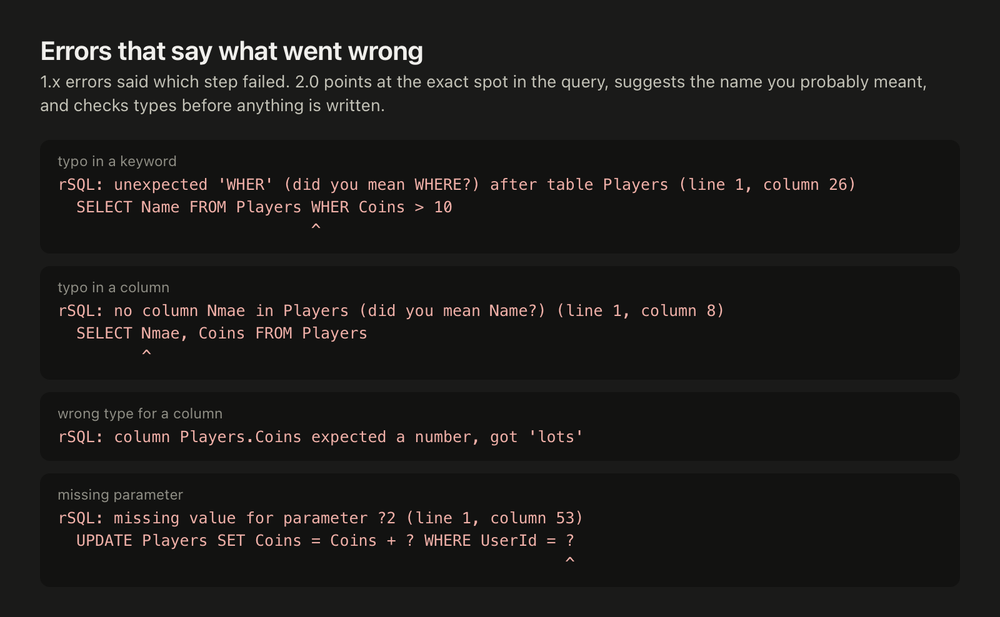
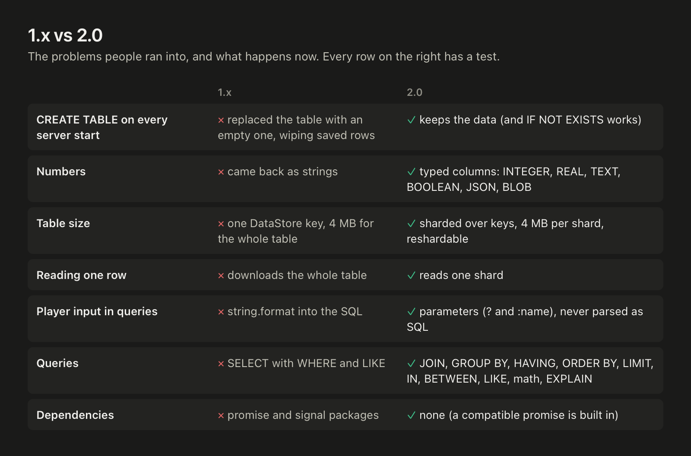
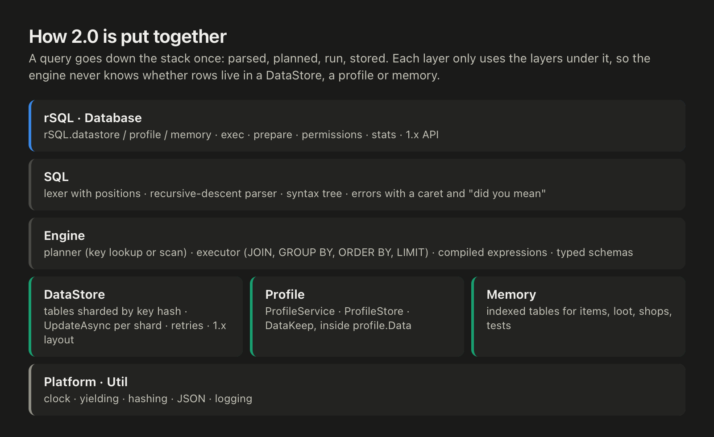

# rSQL

SQL for Roblox DataStores, player profiles and in-memory tables.

[](https://github.com/rustyspottedcatt/rSQL/actions/workflows/ci.yml)
[](https://luau.org)
[](LICENSE)



```lua
local rSQL = require(ReplicatedStorage.rSQL)
local db = rSQL.datastore(DataStoreService:GetDataStore("Game"))

db:exec([[
	CREATE TABLE IF NOT EXISTS Players (
		UserId INTEGER PRIMARY KEY,
		Name   TEXT NOT NULL,
		Coins  INTEGER NOT NULL DEFAULT 0
	)
]])

db:exec("INSERT INTO Players (UserId, Name) VALUES (?, ?)", { player.UserId, player.Name })
db:exec("UPDATE Players SET Coins = Coins + ? WHERE UserId = ?", { 50, player.UserId })

local top = db:exec("SELECT Name, Coins FROM Players ORDER BY Coins DESC LIMIT 10").rows
```

2.0 is a rewrite. The 1.x code had a bug that wiped tables, stored every number as a string and kept each table in a single 4 MB DataStore key, so I started over with a real parser, typed columns and sharded storage. Old scripts and old saved data still work. See [what changed](#what-changed-from-1x).

## Try it in Studio

You need [Rokit](https://github.com/rojo-rbx/rokit) and Roblox Studio.

```bash
rokit install
rojo build dev.project.json -o rSQL-Playground.rbxl
```

Open the place and press Play. Walk onto the yellow pad to earn coins; the board behind it runs `SELECT ... ORDER BY Coins DESC LIMIT 5` every two seconds. With "Enable Studio Access to API Services" on, it uses a real DataStore, otherwise an in-memory database.

The playground also has three examples that are off until you enable them: a loot table, a ProfileStore inventory, and the unmodified 1.x quick start.

To run the tests inside Studio, build `test.project.json` instead and press Run (F8):

```bash
rojo build test.project.json -o rSQL-Tests.rbxl
```

The last line in Output is `[rSQL tests] PASS ...` or `FAIL ...`.

## What you can do with it



Three kinds of storage, one API:

| | Use it for | Where rows live |
|---|---|---|
| `rSQL.datastore(store)` | data shared by every server: leaderboards, guilds, world state | a DataStore, split over several keys |
| `rSQL.profile(profile)` | one player's data, with ProfileService, ProfileStore or DataKeep | inside `profile.Data`, saved by your profile library |
| `rSQL.memory()` | game data you query a lot: items, loot tables, shops | a Luau table, not saved |

And the SQL you'd expect:

- `SELECT` with `WHERE`, `JOIN` / `LEFT JOIN`, `GROUP BY`, `HAVING`, `ORDER BY`, `LIMIT` / `OFFSET`, `DISTINCT`
- `COUNT`, `SUM`, `AVG`, `MIN`, `MAX`, plus `LOWER`, `UPPER`, `LENGTH`, `ROUND`, `COALESCE` and a few more
- `AND` / `OR` / `NOT`, `LIKE`, `IN`, `BETWEEN`, `IS NULL`, and math in expressions (`SET Coins = Coins + 10`)
- `INSERT` with several rows at once, `UPDATE`, `DELETE`
- `CREATE TABLE` with `PRIMARY KEY`, `AUTOINCREMENT`, `NOT NULL`, `UNIQUE`, `DEFAULT`
- `ALTER TABLE` (add, drop or rename columns), `DROP TABLE`, `TRUNCATE`
- `EXPLAIN`, `SHOW TABLES`, `DESCRIBE`
- `?` and `:name` parameters, so player input never becomes SQL

Columns have types (`INTEGER`, `REAL`, `TEXT`, `BOOLEAN`, `JSON`, `BLOB`), so a number goes in and a number comes out.

## How it stores tables in a DataStore



1.x kept a whole table under one DataStore key, so every query downloaded every row and a table could never grow past 4 MB. 2.0 splits each table over several keys (8 by default) by a hash of the primary key. Looking up one player reads one of them. Every write goes through `UpdateAsync` on just the shards it touches, so two servers changing different players don't step on each other.





The trade-off: a query that filters on a non-key column still has to read every shard, and a statement that changes rows in several shards commits one shard at a time. [docs/advanced-usage.md](docs/advanced-usage.md) has the details.

## Errors you can act on



## What changed from 1.x



Your 1.x code keeps running:

```lua
local connection = rSQL:connect(DataStoreService:GetDataStore("PlayerDatastore"), {
	allowCreate = true,
	allowInsert = true,
	allowSelect = true,
	allowUpdate = true,
}):expect()

connection:query("SELECT * FROM Players WHERE ID = '1'"):andThen(print)
```

Tables saved by 1.x load as they are, and tables created through the 1.x API keep the 1.x layout so old and new servers can share them during an update. [docs/migration.md](docs/migration.md) maps every 1.x call to the new one.

## How it's built



```
src/
├── init            public API: datastore / profile / memory / open, plus the 1.x API
├── Database        handles: exec, query, prepare, permissions, statement cache, stats
├── SQL/            lexer, parser, syntax tree, errors with positions
├── Engine/         planner, executor, compiled expressions, schemas, types
├── Storage/        DataStore (sharded and 1.x layout), profile/memory tables
├── Promise         small promise compatible with what 1.x scripts used
├── Legacy          the 1.x API on top of the new engine
└── Platform, Util  runtime detection, hashing, JSON, logging
```

[docs/architecture.md](docs/architecture.md) walks through how a query runs and why the storage looks the way it does.

## Testing

- 91 tests cover the lexer and parser, every statement on the in-memory engine, the DataStore layouts (sharding, retries, size limits, resharding, 1.x data), profiles, the 1.x API and the promise.
- The same suite runs three ways: under Lune, from the Rojo-built place with Roblox's `require` rules (`lune run scripts/emulate-studio`), and inside Studio with `test.project.json`.
- The DataStore tests use a stand-in that copies values like real serialization, enforces the size limit and can throw throttling errors on demand.
- `src/` passes strict type checking with luau-lsp.

## Development

```bash
rokit install
lune run tests/run                      # all tests
lune run scripts/emulate-studio         # same suite from the built Roblox place
lune run scripts/rsql                   # SQL shell (add -- --store dev.db.json to keep data)
lune run bench/run                      # benchmarks -> docs/figures/data/bench.json
lune run scripts/figures && swift tools/render-figures.swift   # rebuild docs/img (macOS)
stylua src tests scripts bench examples && selene src tests
luau-lsp analyze --platform=standard --definitions=types/globals.d.luau --ignore="src/**/*.server.luau" src
```

See [CONTRIBUTING.md](CONTRIBUTING.md).

## Docs

- [Getting started](docs/getting-started.md)
- [SQL reference](docs/basic-usage.md)
- [DataStores, profiles and production use](docs/advanced-usage.md)
- [Recipes](docs/templates.md)
- [Architecture](docs/architecture.md)
- [Benchmarks](docs/benchmarks.md)
- [Moving from 1.x](docs/migration.md)

## License

MIT. See [LICENSE](LICENSE).
