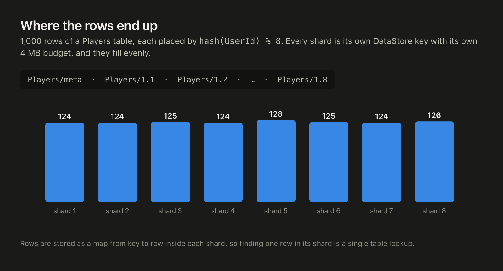
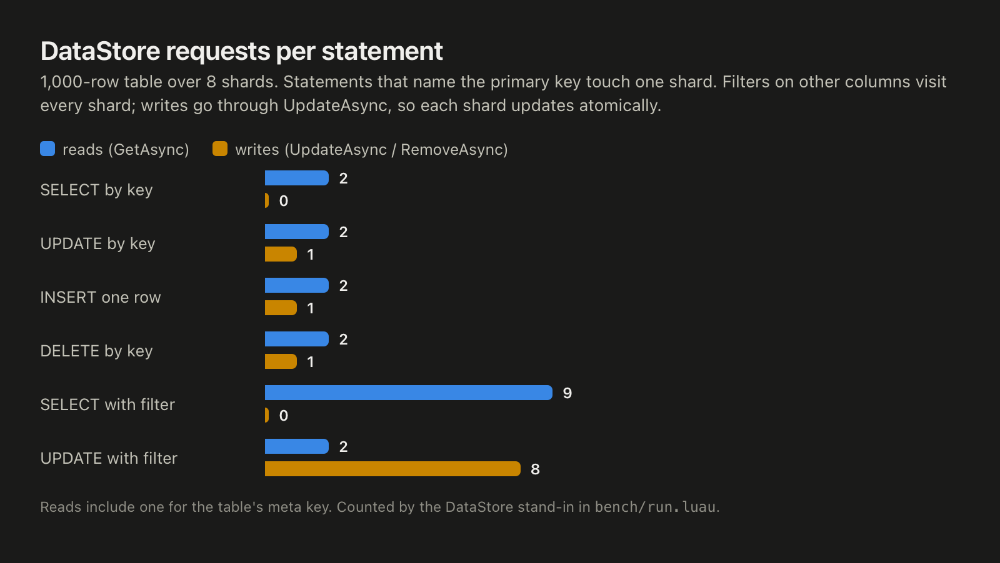

# DataStores, profiles and production use

## How a DataStore table is stored



New tables use the sharded layout:

```
Players/meta      { version = 2, schema, shards = 8, generation = 1, nextId }
Players/1.1       { rows = { [key] = row, ... } }
Players/1.2       ...
Players/1.8
__rsql_tables     list of tables, for SHOW TABLES
```

A row goes to shard `hash(primary key) % shards + 1`. So:

- A lookup by primary key (`WHERE UserId = ?` or `WHERE UserId IN (...)`) reads the meta key and one shard per key.
- Anything else (a filter on another column, `ORDER BY` over the whole table, a `JOIN`) reads every shard.
- Each shard is its own key with its own 4 MB limit, so 8 shards hold about 32 MB.
- Every write is an `UpdateAsync` on the shard that holds the row, so two servers writing different rows don't overwrite each other.

The meta key is cached for the length of one statement, not longer, so a schema change on one server is seen by the next statement on every other server.

`EXPLAIN` tells you which one you'll get:

```lua
db:explain("SELECT * FROM Players WHERE UserId = 42")
--> { "key lookup on UserId (one shard per key)", "filter WHERE" }
db:explain("SELECT * FROM Players WHERE Coins > 100")
--> { "full scan of Players (8 shards)", "filter WHERE" }
```



### Options

```lua
local db = rSQL.datastore(store, {
	shards = 8,            -- for new tables, 1 to 256
	layout = "sharded",    -- or "single" for the 1.x one-key layout
	retries = 3,           -- retries on throttling and network errors
	backoffSeconds = 0.5,  -- first retry delay, doubles each time
	prefix = "",           -- prepended to every key, e.g. "v2/"
})
```

Keys are limited to 50 characters by Roblox; rSQL checks `prefix + table name` fits before creating a table.

### When a table outgrows its shards

A shard over 4 MB makes the write fail with:

```
rSQL: UpdateAsync(Players/1.3) is over the DataStore size limit; give the table more shards with db:reshard()
```

`db:reshard("Players", 32)` copies every row into a new generation of keys, switches the meta key over, then removes the old keys. Run it from one server while nothing else writes to the table (a maintenance script, or a migration on a private server). It needs the `alter` permission.

It also converts a 1.x single-key table to the sharded layout.

## What's atomic and what isn't

- One `UpdateAsync` is atomic. A statement whose rows all live in one shard (any statement by primary key, and anything on a single-layout table) is atomic.
- A statement that changes rows in several shards commits one shard at a time. If a later shard fails after the retries, the earlier ones stay written and `exec` raises.
- `UNIQUE` on a column that isn't the primary key is checked before writing. Two servers inserting the same value at the same moment can both succeed. Make the column the primary key if it has to be unique.
- `AUTOINCREMENT` ids are reserved with an `UpdateAsync` on the meta key, so two servers never get the same id.

For money-like values, keep each change to one row by primary key and use expressions instead of read-then-write:

```lua
-- atomic: one UpdateAsync, computed from the stored value
db:exec("UPDATE Players SET Coins = Coins - ? WHERE UserId = ? AND Coins >= ?", { price, userId, price })
```

`affected` tells you whether the row matched, so the check and the change happen in the same atomic step.

## Profiles

```lua
local db = rSQL.profile(profile)
```

The tables live in `profile.Data`. Your profile library loads, session-locks and saves it; rSQL never calls DataStores itself here. Each statement changes `profile.Data` in place, so it's saved with the profile's next auto-save or release.

Profile tables are plain Luau tables, so lookups by primary key and scans are both quick. Keep them to one player's data.

## Memory

```lua
local items = rSQL.memory()
```

Nothing is saved. Lookups by primary key use a hash index; everything else scans. 10,000 rows scan in a few milliseconds (see [benchmarks](benchmarks.md)), so load your item, loot or shop tables at startup and query them freely.

## Permissions

```lua
local readOnly = rSQL.datastore(store, { permissions = "read" })
local noSchema = rSQL.datastore(store, { permissions = "write" })   -- select, insert, update, delete
local custom   = rSQL.datastore(store, { permissions = { select = true, insert = true } })
```

The default is `"all"`. A refused statement raises `rSQL: DROP isn't allowed on this database handle`. Use a read-only handle for anything that runs queries from admin commands or debug panels.

## Logging and metrics

```lua
local db = rSQL.datastore(store, {
	onQuery = function(info)
		-- info: { sql, kind, ms, reads, writes, rows, ok, error }
		if info.ms > 200 then
			warn(("slow query (%d ms, %d reads): %s"):format(info.ms, info.reads, info.sql))
		end
	end,
	logger = rSQL.Logger.new({ level = "warn" }),
})

print(db.stats) -- { queries, reads, writes, ms, cacheHits }
```

## Budgets

Every read is a `GetAsync` and every write an `UpdateAsync`, and they count against the [DataStore limits](https://create.roblox.com/docs/cloud-services/data-stores/error-codes-and-limits) like any other call. Rules of thumb:

- Look players up by primary key. One read for meta plus one per key.
- Don't run scans in a loop. A leaderboard query every few seconds on 8 shards is 9 reads each time. For anything faster, keep a copy in `rSQL.memory()` or use an OrderedDataStore.
- Batch inserts: `INSERT ... VALUES (...), (...), (...)` writes each touched shard once.

## Custom storage

`rSQL.open(adapter, options)` takes any object that implements the adapter interface in `src/Storage/Adapter.luau` (list, get, scan, insert, modify, and so on). The test suite's fake DataStore and both built-in backends are examples.
