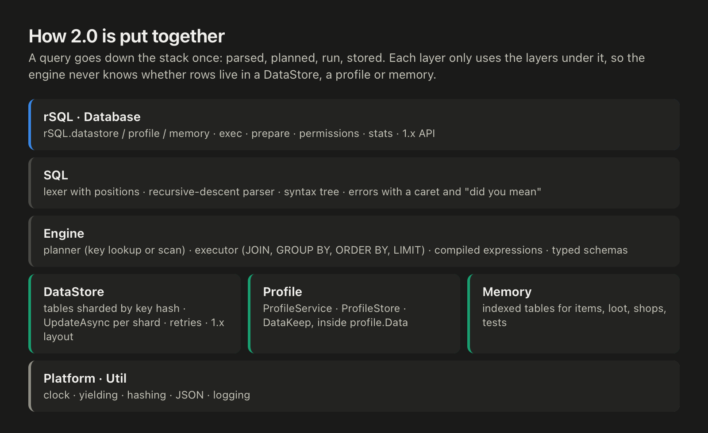

# Architecture



rSQL is split into layers, and each one only uses the layers below it:

| Layer | Files | Job |
|---|---|---|
| API | `init`, `Legacy` | `rSQL.datastore / profile / memory / open`, and the 1.x `connect` API on top |
| Database | `Database`, `Permissions`, `Promise` | handles, statement cache, permissions, stats, `onQuery` |
| SQL | `SQL/Lexer`, `SQL/Parser`, `SQL/Ast`, `SQL/Errors` | text to syntax tree, with positions for errors |
| Engine | `Engine/Planner`, `Engine/Executor`, `Engine/Expression`, `Engine/Schema`, `Engine/Types` | runs a syntax tree against storage |
| Storage | `Storage/Adapter`, `Storage/TableAdapter`, `Storage/DataStoreAdapter` | where rows live |
| Platform | `Platform`, `Util/*` | Roblox vs Lune differences, hashing, JSON, logging |

Nothing in SQL or Engine touches a Roblox API. That's what lets the whole engine run under Lune for tests and benchmarks, and why storage is behind an interface.

## How a query runs

Take `UPDATE Players SET Coins = Coins + ? WHERE UserId = ?` with `{ 50, 42 }`.

1. **Cache.** `Database` looks the SQL text up in an LRU cache of parsed statements (128 entries). A hit skips the next two steps.
2. **Lex.** `Lexer` turns the text into tokens, each with its offset in the string. Keywords are case-insensitive, `<>` becomes `!=`, `?` and `:name` become parameter tokens.
3. **Parse.** `Parser` is a hand-written recursive-descent parser, with one function per precedence level for expressions (`OR` < `AND` < `NOT` < comparisons < `||` < `+ -` < `* / %` < unary). It builds a syntax tree and counts positional parameters so a missing one is caught before anything runs.
4. **Permissions.** The statement kind is checked against the handle's permission set.
5. **Plan.** `Planner` looks at `WHERE`. If it pins the primary key to constants or parameters (`=`, or `IN (...)`, possibly inside `AND`), the plan is a key lookup on those keys. Otherwise it's a scan.
6. **Compile.** `Expression.compile` turns each expression into a Luau closure `(row, params, agg) -> value` once, so evaluating `Coins + ?` per row is a function call, not a tree walk.
7. **Execute.** `Executor` asks storage to `modify` the planned keys. The storage layer hands each row to a callback that re-checks `WHERE`, computes the new values, converts them to the column types and validates `NOT NULL` and `UNIQUE`.
8. **Result.** Rows, `affected`, the plan text and `{ ms, reads, writes }` come back. `onQuery` is called with the same numbers.

`SELECT` runs the same way with a longer pipeline: fetch, `JOIN` (hash join when the `ON` is an equality, nested loop otherwise), `WHERE`, `GROUP BY` and aggregates, `HAVING`, projection, `DISTINCT`, `ORDER BY`, `OFFSET` / `LIMIT`.

## Storage

Every backend implements the same interface (`Storage/Adapter.luau`):

```lua
listTables, getTable, createTable, dropTable, setSchema,
get(name, keys), scan(name), insert(name, rows),
modify(name, keys?, fn), truncate(name), allocateIds(name, count),
beginStatement?, endStatement?
```

`modify` is the important one. The executor never reads a row, changes it and writes it back as separate steps; it passes a function and the storage layer applies it inside whatever atomic primitive it has. For DataStores that's `UpdateAsync`, so the read and the write of a shard happen in one call and a concurrent change on another server can't be lost.

`TableAdapter` keeps tables in a Luau table. It backs both `rSQL.memory()` (with a primary-key index) and `rSQL.profile()` (inside `profile.Data`).

`DataStoreAdapter` has two layouts:

- **sharded** (default): a meta key with the schema, plus N shard keys. A row's shard is `hash32(primary key) % N`. See [advanced usage](advanced-usage.md) for the key names and what that means for cost and atomicity.
- **single**: the 1.x layout, the whole table under one key. Kept so 1.x and 2.x servers can share data during an update.

Within one statement the adapter caches the meta key, so a statement doesn't re-read it for every step. The cache is dropped at the end of the statement and after every write to the meta key.

DataStore calls go through one wrapper that retries throttling and network errors with exponential back-off, turns "value too large" into an error that says which key and what to do, and never retries rSQL's own errors.

## Errors

Every error is raised with `error(message, 0)` and starts with `rSQL:`. Syntax and semantic errors carry the offset of the token that caused them, and `SQL/Errors` turns that into a line, a column and a caret under the spot. Unknown keywords, tables and columns get a "did you mean" from an edit-distance search over the names that would have been valid.

## Types

Values are stored as plain Luau values: numbers, strings, booleans, tables, buffers. Column types convert on the way in (`'42'` into an `INTEGER` becomes `42`) and reject what can't be converted. `NULL` is `nil` in rows; `rSQL.NULL` exists only so a parameter list can contain it.

Comparisons follow SQL: any comparison with `NULL` is unknown, which `WHERE` treats as false. Numbers compare as numbers even when one side is a numeric string, which keeps 1.x data (stored as strings) usable in `WHERE Score > 10`.

## Testing

The suite runs the same specs three ways:

- `lune run tests/run`: plain Lune.
- `lune run scripts/emulate-studio`: builds the Rojo test place, loads it with `@lune/roblox`, and runs every ModuleScript from the place with Roblox's `require` rules. This catches mistakes in the Rojo tree, require paths and module names that a plain Lune run can't.
- Studio: `test.project.json` builds a place whose server script runs the suite and prints PASS or FAIL.

DataStore behavior is tested against `tests/support/FakeDataStore.luau`, which copies values on the way in and out like real serialization, enforces a size limit, counts requests and bytes, and can fail the next N calls to test retries.

## Decisions

The reasoning behind the bigger choices is written up in [docs/adr](https://github.com/rustyspottedcatt/rSQL/tree/main/docs/adr).
