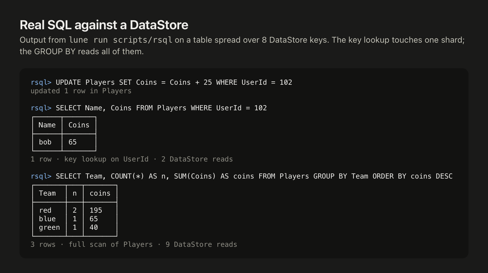
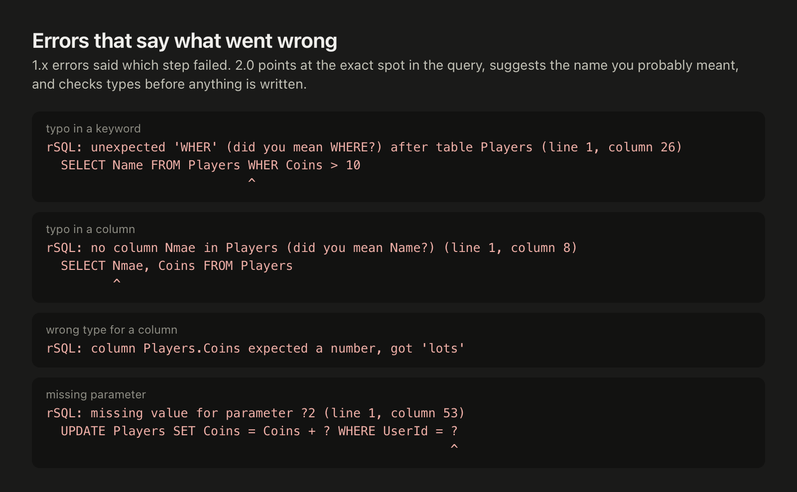

# SQL reference

rSQL speaks a practical subset of SQL. If you've used SQLite or MySQL most of this will look familiar.



## Results

`db:exec(sql, params)` returns a table:

| Field | What it is |
|---|---|
| `rows` | array of rows, each a table keyed by column name |
| `columns` | column names, in order |
| `affected` | rows inserted, updated or deleted |
| `insertIds`, `lastInsertId` | primary keys of inserted rows |
| `message` | short description, like `updated 3 rows in Players` |
| `plan` | how the rows were found, like `key lookup on UserId` |
| `stats` | `{ ms, reads, writes }` for this statement |

## Tables

```sql
CREATE TABLE [IF NOT EXISTS] Name (
	Column TYPE [PRIMARY KEY] [AUTOINCREMENT] [NOT NULL] [UNIQUE] [DEFAULT value],
	...
	[, PRIMARY KEY (Column)]
)

DROP TABLE [IF EXISTS] Name
TRUNCATE TABLE Name
ALTER TABLE Name ADD [COLUMN] Column TYPE ...
ALTER TABLE Name DROP [COLUMN] Column
ALTER TABLE Name RENAME COLUMN Old TO New
SHOW TABLES
DESCRIBE Name
```

Without a `PRIMARY KEY`, rSQL adds a hidden auto-incrementing `_rowid`. `SELECT *` never returns it.

`AUTOINCREMENT` works on an `INTEGER PRIMARY KEY`. Leave the column out of the `INSERT` and rSQL fills it in.

### Types

| Type | Also accepted | Holds |
|---|---|---|
| `INTEGER` | `INT`, `BIGINT` | whole numbers |
| `REAL` | `NUMBER`, `FLOAT`, `DOUBLE`, `NUMERIC`, `DECIMAL` | any number |
| `TEXT` | `STRING`, `VARCHAR(n)`, `CHAR` | strings |
| `BOOLEAN` | `BOOL` | `true` / `false` (also takes 1/0 and 'true'/'false') |
| `JSON` | | any table a DataStore can save |
| `BLOB` | `BUFFER` | buffers or raw strings |
| (none) | `ANY` | anything, unchecked |

Values are converted on write: `'500'` going into an `INTEGER` column is stored as `500`. Values that can't be converted are rejected with an error that names the column.

## Reading

```sql
SELECT [DISTINCT] expr [AS alias], ... | *
FROM Table [alias]
[[LEFT] JOIN Other [alias] ON condition] ...
[WHERE condition]
[GROUP BY expr, ...]
[HAVING condition]
[ORDER BY expr|alias|position [ASC|DESC], ...]
[LIMIT count [OFFSET skip]]
```

Some examples:

```sql
SELECT Name, Coins FROM Players WHERE Coins > 100 ORDER BY Coins DESC LIMIT 10
SELECT Team, COUNT(*) AS players, AVG(Coins) AS avg FROM Players GROUP BY Team HAVING COUNT(*) > 5
SELECT p.Name, i.Item FROM Players p JOIN Items i ON i.Owner = p.UserId WHERE p.UserId = ?
SELECT * FROM Items WHERE Rarity IN ('epic', 'legendary') AND Name LIKE '%staff%'
```

`ORDER BY` puts `NULL` first when ascending. `LIKE` uses `%` for any run of characters and `_` for one character, and ignores case. MySQL-style `LIMIT 20, 10` (skip 20, take 10) also works.

## Writing

```sql
INSERT INTO Table [(columns)] VALUES (values), (values), ...
UPDATE Table SET Column = expr, ... [WHERE condition]
DELETE FROM Table [WHERE condition]
```

`SET` can use the row's current values: `UPDATE Players SET Coins = Coins + 10, Level = Level + 1 WHERE UserId = ?`.

Without `WHERE`, `UPDATE` and `DELETE` apply to every row, same as any SQL database.

## Expressions

| Kind | Operators and functions |
|---|---|
| comparison | `=` `!=` `<>` `<` `<=` `>` `>=` |
| logic | `AND` `OR` `NOT` |
| math | `+` `-` `*` `/` `%` |
| text | `\|\|` (concatenate) |
| tests | `x IN (...)`, `x BETWEEN a AND b`, `x LIKE 'pattern'`, `x IS NULL`, each with `NOT` |
| aggregates | `COUNT(*)`, `COUNT(x)`, `COUNT(DISTINCT x)`, `SUM`, `AVG`, `MIN`, `MAX` |
| functions | `LOWER`, `UPPER`, `LENGTH`, `ABS`, `ROUND(x, digits)`, `FLOOR`, `CEIL`, `COALESCE` / `IFNULL`, `SUBSTR(s, start, len)`, `TRIM` |

`NULL` works like it does in SQL: a comparison with it is neither true nor false, so `WHERE Level > 1` skips rows where `Level` is `NULL`. Use `IS NULL` to find them.

Strings use single quotes, and a doubled quote inside is a literal quote (`'it''s'`). Double quotes also work, for 1.x compatibility. Backticks quote names that clash with keywords: `` `Order` ``.

## Parameters

```lua
db:exec("SELECT * FROM Players WHERE Team = ? AND Coins > ?", { "red", 100 })
db:exec("SELECT * FROM Players WHERE UserId = :id", { id = player.UserId })
db:exec("UPDATE Players SET Guild = ? WHERE UserId = ?", { rSQL.NULL, player.UserId })
```

A Luau table can't hold `nil`, so pass `rSQL.NULL` to write `NULL`. A parameter with no value is an error, not a silent `nil`.

## Prepared statements

```lua
local getCoins = db:prepare("SELECT Coins FROM Players WHERE UserId = ?")
local coins = getCoins:run({ player.UserId }).rows[1].Coins
```

`exec` caches parsed statements too, so this is mostly about readability.

## Errors



Every error starts with `rSQL:`, says what went wrong and, for syntax errors, shows the line and column with a caret under the spot. Misspelled keywords, tables and columns come with a suggestion.

Next: [DataStores, profiles and production use](advanced-usage.md).
