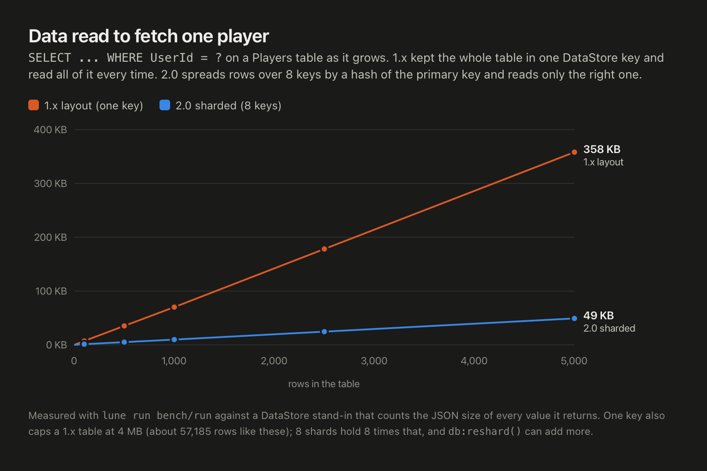
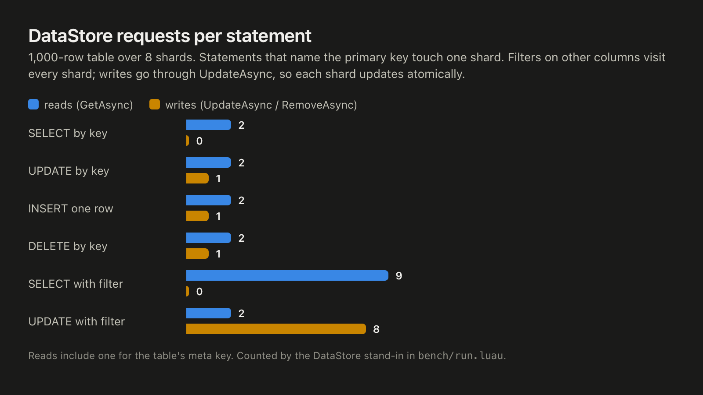
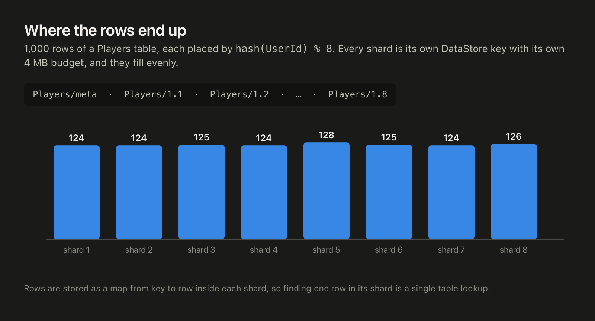

# Benchmarks

Run them with `lune run bench/run`. The raw numbers go to `docs/figures/data/bench.json`, and the charts here are drawn from that file.

These run under Lune on a laptop against the fake DataStore from the test suite, which counts requests and the size of what each request returns. On a real server the DataStore round trip (tens of milliseconds) dominates, so requests and bytes are the numbers that carry over. The times are only useful for comparing the two layouts with each other.

## Bytes read per primary-key lookup

| Rows | 1.x layout | 2.0, 8 shards | Less data |
|---|---|---|---|
| 100 | 7.2 KB | 1.3 KB | 5.7x |
| 1,000 | 70.2 KB | 9.8 KB | 7.2x |
| 5,000 | 358 KB | 49 KB | 7.3x |

Both layouts make 2 requests per lookup (a meta or registry read, then the data). The 1.x layout reads the whole table every time; the sharded one reads an eighth of it. With more shards the gap grows with the shard count.

The 1.x layout also stops working at 4 MB per table, which these test rows (about 73 bytes each) reach at around 57,000 rows. Eight shards hold about 8 times that.

## Requests per statement

1,000 rows, 8 shards:

| Statement | Reads | Writes |
|---|---|---|
| SELECT by key | 2 | 0 |
| UPDATE by key | 2 | 1 |
| INSERT one row | 2 | 1 |
| DELETE by key | 2 | 1 |
| SELECT with a filter on another column | 9 | 0 |
| UPDATE with a filter on another column | 2 | 8 |

The filtered `UPDATE` reads the meta key and then does its reading inside the 8 `UpdateAsync` calls, one per shard.

## How evenly rows spread

1,000 sequential user ids over 8 shards land 124 to 128 per shard (125 would be perfectly even). The hash is FNV-1a over the key's string form, so ids that are close together don't cluster.

## Parsing and memory

| | Result |
|---|---|
| Parsing a 100-character `SELECT` | about 38,000 per second |
| Same query, cached, on a 10-row table | about 65,000 per second |
| In-memory, 10,000 rows, key lookup | 0.011 ms |
| In-memory, 10,000 rows, filter on another column | 2.7 ms |

Since parsed statements are cached by their text, the parse cost is paid once per distinct query, which is another reason to use parameters instead of formatting values into the SQL.
