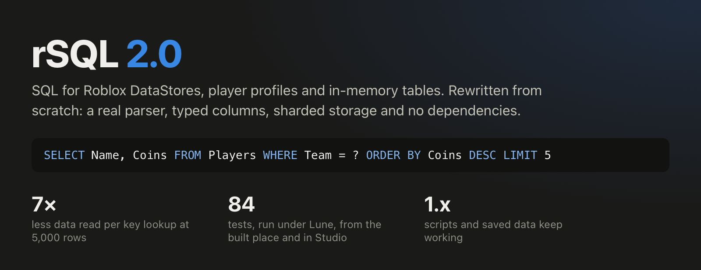

# Introduction

rSQL lets you store and query Roblox game data with SQL. You write `SELECT`, `INSERT`, `UPDATE` and `DELETE`, and rSQL turns them into DataStore calls, edits to a player's profile, or lookups in an in-memory table.

## When it helps

- Data that's naturally a table: players, items, guild members, match history. Anything where you'd otherwise write loops over nested tables to filter, sort or count.
- Queries you'd otherwise write by hand. "Top 10 by coins", "all rare items with a fire element" and "how many players per team" are one line each.
- Data shared across servers. The DataStore backend splits tables over several keys and writes each one with `UpdateAsync`.

## When it doesn't

- A single player's save that you always load whole. A profile library (ProfileStore, ProfileService, DataKeep) is the right tool for that. You can still put rSQL tables inside the profile if you want SQL over them.
- Big global queries every frame. Filtering on a non-key column reads every shard of a DataStore table. That's fine every few seconds, not every frame. Keep hot data in memory.
- Transactions across many rows. Each shard is updated atomically, but a statement that touches several shards commits them one at a time.

## What's new in 2.0

2.0 is a rewrite. The short version:

- `CREATE TABLE` no longer wipes an existing table (1.x did, every time)
- typed columns, so numbers stay numbers
- tables split over several DataStore keys instead of one 4 MB key
- a real parser with JOIN, GROUP BY, ORDER BY, LIMIT, LIKE, IN, BETWEEN, math and EXPLAIN
- `?` and `:name` parameters, so player input can't change your query
- error messages that point at the exact spot
- no dependencies
- the 1.x API still works, and 1.x data loads as it is

Next: [Getting started](getting-started.md).
