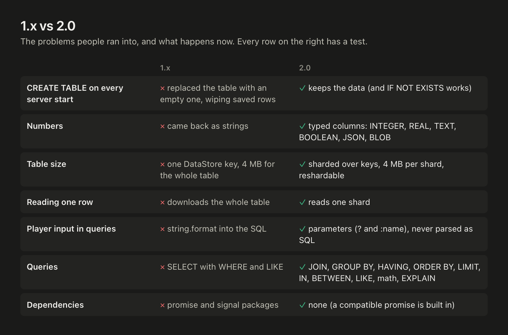

# Moving from 1.x



You don't have to change anything to update. The 1.x API is still there, runs on the new engine, and reads data saved by 1.x as it is. This page is for when you want to move to the new API, and for the few places where 2.0 behaves differently on purpose.

## Behavior that changed

- **`CREATE TABLE` on an existing table keeps the data.** 1.x replaced the table with an empty one, so a quick start that ran `CREATE TABLE` on every server start wiped every saved row each time a server started. Through the 1.x API, 2.0 now leaves the table alone and logs a warning. Through the new API it raises an error unless you write `CREATE TABLE IF NOT EXISTS`.
- **Numbers stay numbers.** 1.x saved every value as a string. Old rows still contain strings, and comparisons treat numeric strings as numbers, so `WHERE Score > 10` works on old and new rows alike. New rows keep the type you insert.
- **The first column is the key** for tables created through the 1.x API without a declared primary key, so inserting the same `ID` twice is an error instead of a second copy of the row.
- **Unknown columns, missing tables and syntax errors are errors.** 1.x often printed a warning and returned an empty result. The promise from `query` now rejects with a message that points at the problem.

## Calls

| 1.x | 2.0 |
|---|---|
| `rSQL:connect(store, config):expect()` | `rSQL.datastore(store, { permissions = config })` |
| `rSQL:connectToProfileService(profile, config)` | `rSQL.profile(profile, { permissions = config })` |
| `rSQL:connectToDatakeep(keep, config)` | `rSQL.profile(keep, { permissions = config })` |
| `connection:query(sql):expect()` | `db:exec(sql, params).rows` |
| `connection:query(sql):andThen(fn)` | `db:query(sql, params):andThen(function(result) fn(result.rows) end)` |
| `string.format("... '%s'", name)` | `"... ?"` with `{ name }` |
| `CREATE TABLE Players (ID, Name, Score)` | `CREATE TABLE IF NOT EXISTS Players (ID INTEGER PRIMARY KEY, Name TEXT, Score INTEGER DEFAULT 0)` |

Your 1.x config table works as a permission set as it is: `allowSelect`, `allowInsert`, `allowUpdate`, `allowDelete`, `allowCreate`, `allowDrop`, `allowTruncate`, and `allowAlterAdd` / `allowAlterDrop` (both turn on `ALTER`).

Two differences between `query` and `exec`: `exec` returns the whole result (rows, `affected`, ids, stats) instead of only rows or a message string, and it raises instead of rejecting.

## Data

Tables written by 1.x sit under one DataStore key named after the table. 2.0 reads and writes them in that layout, so 1.x servers still running during an update see every change.

Once every server runs 2.0, you can move a table to the sharded layout:

```lua
local db = rSQL.datastore(DataStoreService:GetDataStore("PlayerDatastore"))
db:reshard("Players", 8)
```

Run it once, from one server, while nothing writes to that table. It reads the old key, writes the shards, switches the table over and removes the old key. After that, 1.x servers can't read the table, so don't do this while any are still up.

Old values stay strings. A table created by 1.x has untyped columns (`CREATE TABLE Players (ID, Name, Score)`), which accept anything and convert nothing. You can leave it that way, since comparisons already treat numeric strings as numbers, or copy the rows into a new typed table with a short Luau loop.

## Step by step

1. Update the module. Nothing else changes; check Output for the `kept its data` warning to find scripts that run `CREATE TABLE` on start.
2. Replace `string.format` queries with parameters. This is the change that matters most for safety.
3. Move scripts to `rSQL.datastore` and `db:exec` one at a time. Both APIs can run side by side on the same DataStore.
4. When no 1.x servers are left, reshard the big tables.
